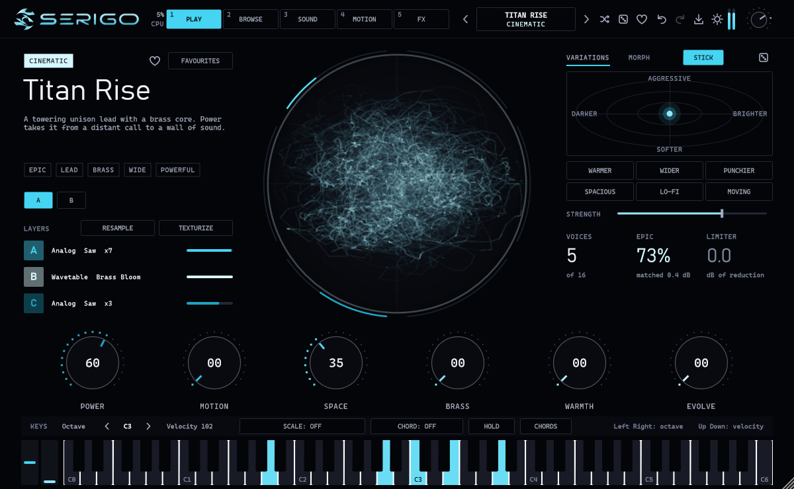
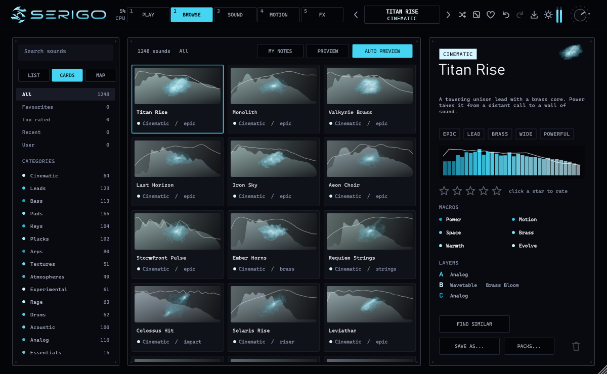
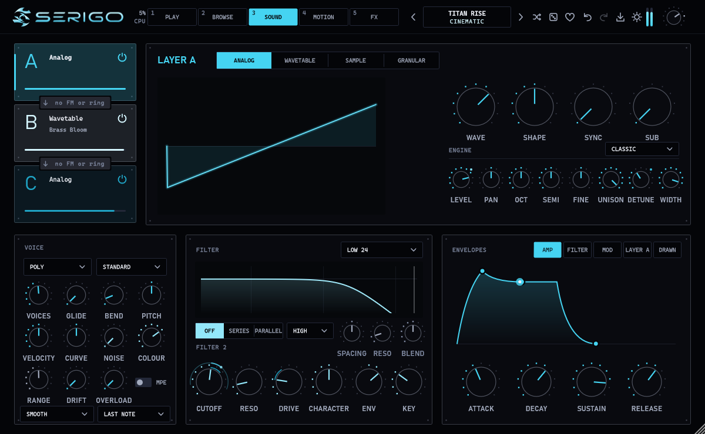
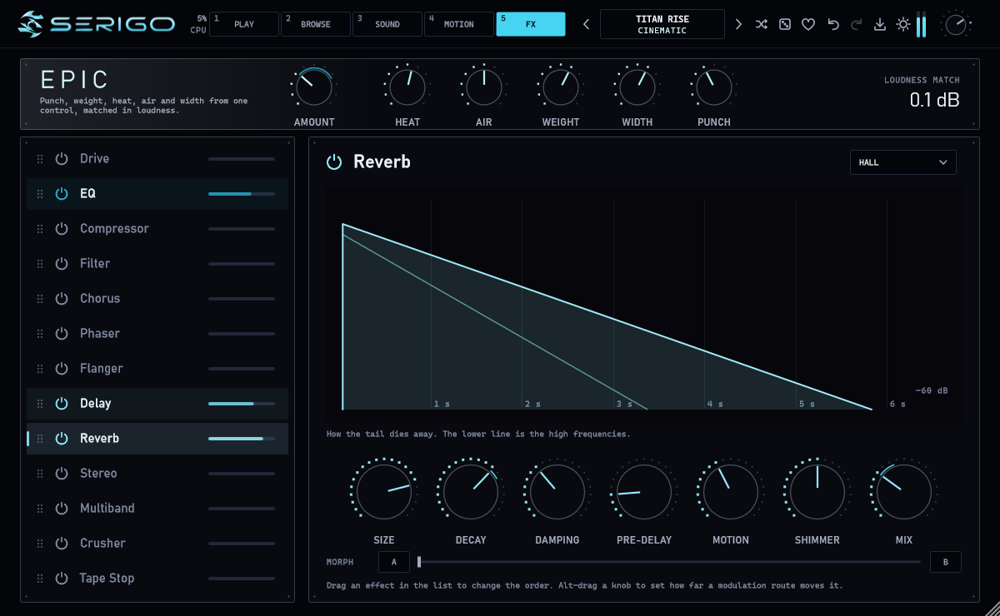

# SERIGO

**A hybrid synthesizer for Windows. VST3 plugin and standalone app.**

Three layers per sound, each one analog, wavetable, sample or granular, through one filter, thirteen
effects and a live oscilloscope. 1,248 factory presets, every one with six named macros.

### [Download the installer (latest version)](https://github.com/jesaias1/SERIGO/releases/latest)

### [Open the SERIGO page](https://jesaias1.github.io/SERIGO/)

## What it does

- **Four engines, three layers.** Analog oscillators with unison up to seven voices, sixteen wavetables,
  eighteen sampled instruments and a granular engine. Any layer can frequency- or ring-modulate the next.
- **1,248 presets in 15 categories**: Cinematic, Leads, Bass, Pads, Keys, Plucks, Arps, Textures,
  Atmospheres, Experimental, Rage, Drums, Acoustic, Analog and Essentials. Search, tags, ratings, favourites and a shuffle button. Browse them as a list, as a gallery of cards, or on a map where sounds that sound alike lie together.
- **Six macros per sound.** Each preset names its own six knobs, so the useful moves are always on the first page.
- **A variation pad.** Drag to make a sound brighter, darker, more aggressive or softer, with the sound following your hand and staying where you leave it; six chips make it warmer, wider, punchier, more spacious, lo-fi or moving. A four-corner morph pad blends four sounds. Undo brings the original back.
- **Thirteen effects** in an order you choose: drive, EQ, compressor, filter, chorus, phaser, flanger, delay,
  reverb, stereo, multiband, crusher and tape stop.
- **Modulation by drag and drop**: LFOs with drawn shapes, a drawn envelope, a step sequencer, an arpeggiator with patterns of up to 64 steps, and MPE. A modulation web shows every route as a line you can drag.
- **An oscilloscope worth looking at.** Five display modes, including one that traces the outline of any picture you give it.
- **Grains in time.** Granular layers can fire their grains on the beat, with four grain shapes. Put an LFO on Position for the chopped-sample sound of house records.
- **Texturize and Resample.** Drop in a sample of your own and it is blended into the current sound as a granular layer, or keep the last few seconds of what you played as a new layer.
- **A chord brain.** The chords of your key, the ones that most often come next, and a memory for four of your own.
- **Colour themes.** Four surfaces including a light one, eleven accents, and a first-run chooser.
- **Play it from the computer keyboard.** Two and a half octaves on two rows, on any keyboard layout, with scale lock and chord mode.

## Install

1. Download `SERIGO-…-win64-setup.exe` from the [latest release](https://github.com/jesaias1/SERIGO/releases/latest).
2. Run it. The installer is not code-signed yet, so Windows shows a blue "Windows protected your PC" box:
   choose **More info**, then **Run anyway**.
3. Pick the VST3 plugin, the standalone app, or both.
4. In your music software, rescan plugins. SERIGO appears as an instrument.

### Without the installer

Prefer not to run a setup program? The same release has `SERIGO-…-win64-vst3.zip`: the VST3 plugin only,
with nothing to run. Unzip it, copy the `SERIGO.vst3` folder to `C:\Program Files\Common Files\VST3`
and rescan plugins in your music software.

**Requirements:** Windows 10 or 11, 64-bit. For the plugin, any host that loads VST3 instruments.

## How it was built

C++20 and JUCE 8. The sound engine is free of JUCE and of any allocation, lock or file access on the audio
thread. An automated suite of more than 28,000 checks runs on every change: every preset is rendered and
measured, state from earlier versions is loaded and compared, and the plugin passes pluginval at its
strictest level.

## Licence

© 2026 jesaias. All rights reserved. SERIGO is free to download and use for making music.
The source code is not published.
